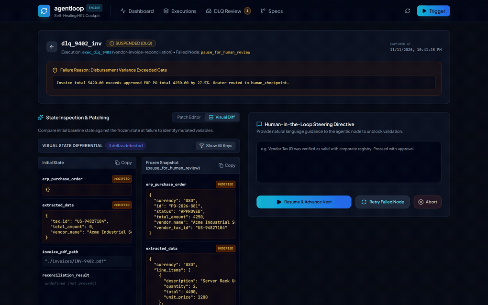
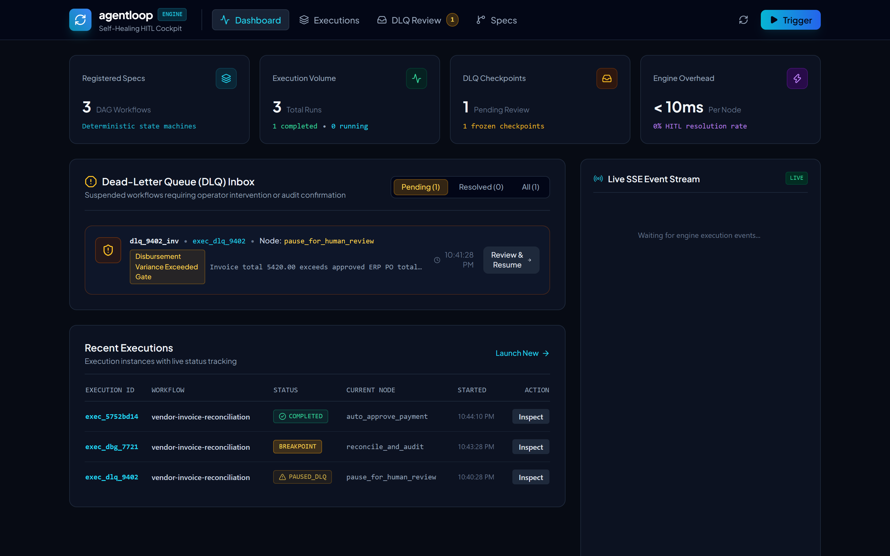
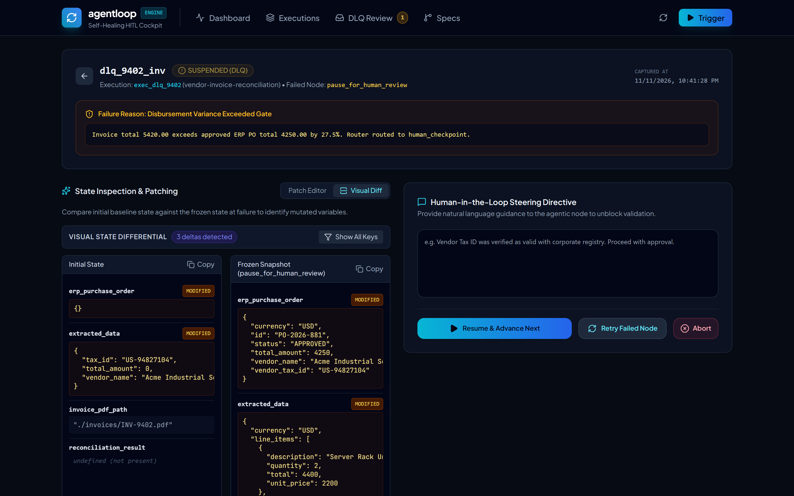
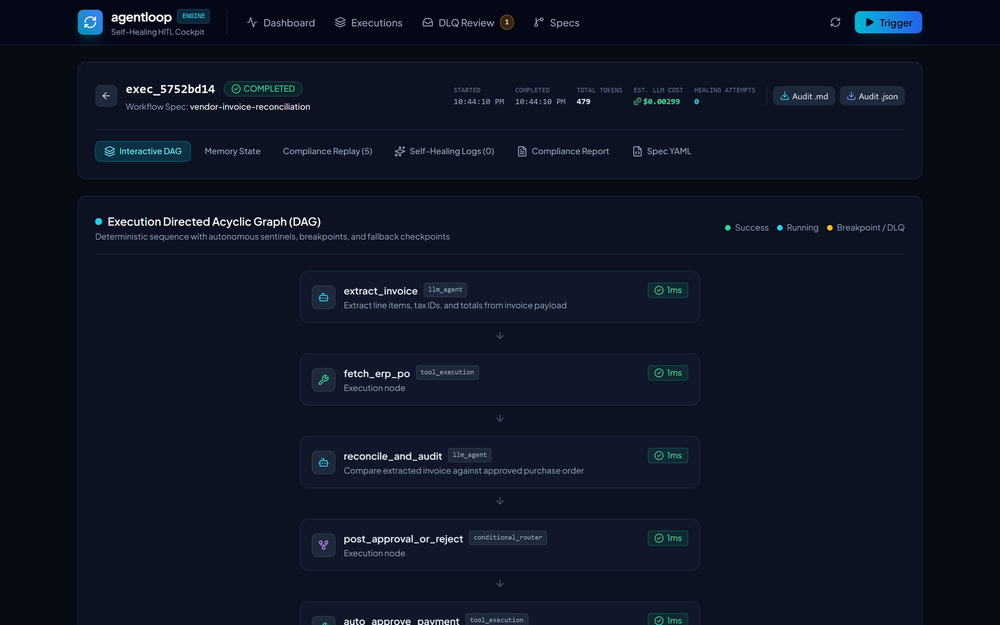
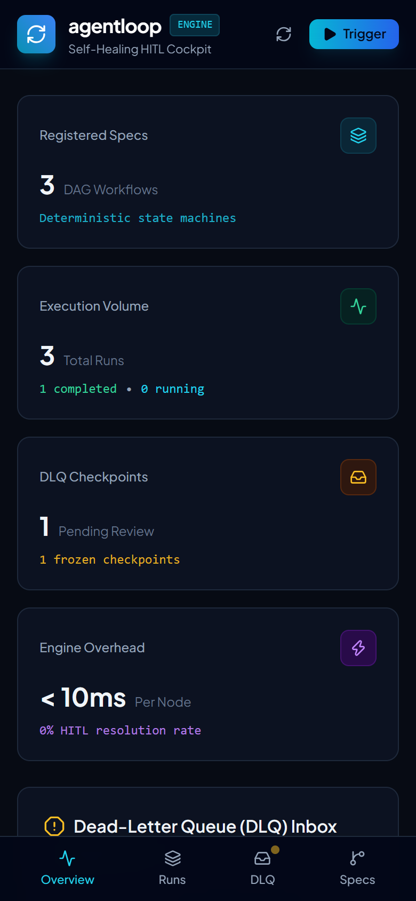

<p align="center">
  
</p>

<h1 align="center">agentloop</h1>

<p align="center">
  <strong>Self-Healing Autonomous Enterprise Workflow Engine with Dead-Letter Queues & Human-in-the-Loop</strong>
</p>

<p align="center">
  <a href="#live-demo">Demo</a> •
  <a href="#core-capabilities">Features</a> •
  <a href="#web-cockpit-and-visual-inspection">Cockpit UI</a> •
  <a href="#quickstart">Quickstart</a> •
  <a href="#architecture">Architecture</a> •
  <a href="#rest-api-reference">API</a> •
  <a href="#benchmarks">Benchmarks</a>
</p>

<p align="center">
  
  
  
  
  
</p>

---

## Live Demo



agentloop is a deterministic workflow engine written in Go with an embedded React 19 cockpit. It treats AI agent execution as a recoverable state machine with sub-25ms node transition overhead, automated self-healing loops, state freezing in Dead-Letter Queues (DLQ), and one-click human intervention.

---

## The Problem

More than 85% of autonomous AI agent pilots stall or fail in production environments due to recurring failure modes:

1. Brittle Tool Execution: Third-party APIs change field names, time out, or return 502 Bad Gateway responses. Unconstrained agents enter recursive retry loops or hallucinate parameters.
2. Context and State Loss: If a multi-step business process fails at step 5 of 6, typical agent frameworks discard the entire transaction without an ability to rewind and repair context.
3. Lack of Human Safety Nets: When an agent encounters low confidence or unrecoverable schema errors, it either makes an unverified guess or crashes without an escalation path.
4. Runaway Spend and Unpredictable Costs: Infinite reflection loops or prompt explosions rapidly deplete API quotas without deterministic circuit breakers.

agentloop resolves these issues by combining deterministic directed acyclic graphs (DAGs) with autonomous self-healing sentinels, token and cost budget guards, checkpoint state freezing, and an operator console.

---

## Web Cockpit and Visual Inspection

agentloop compiles into a single binary containing an embedded React 19 operations cockpit. Operators monitor active workflows, inspect breakpoint states, and resolve incidents without external dependencies.

### Enterprise Dashboard
Real-time telemetry stream, active execution states, token metrics, and instant Dead-Letter Queue alerts.


### Side-by-Side Visual State Diff & HITL Patching
Inspect frozen DLQ memory against baseline state with variable diff highlighting (added, modified, removed) and operator resumption controls.


### DAG Step-Through Breakpoint Debugger
Set execution breakpoints directly on DAG nodes, advance step-by-step, and inspect memory state before each state transition.


### Responsive Mobile Operations
Full operational control across handheld viewports (390px iPhone, tablets) with quick-access navigation and instant alert resolution.
<p align="center">
  
</p>

---

## Core Capabilities

- Deterministic Workflow DAG: Combines deterministic business logic (HTTP REST, SQL queries, JSON expression transforms) with probabilistic LLM reasoning nodes.
- Autonomous Self-Healing Loop: When a node fails schema validation or confidence checks, an internal reflection engine analyzes the error, categorizes the fault, and synthesizes a surgical repair prompt without losing prior state.
- Cost & Token Budget Sentinel: Enforces hard limits on token usage and estimated dollar spend per execution. If limits are reached, the execution freezes to DLQ to prevent cost overruns.
- Multi-Model Fallback Cascades: Automatically fails over across providers (e.g. OpenAI to Anthropic or local Ollama) if a primary model is throttled or times out.
- Webhook Ingestion Gateway: Ingests external webhook triggers with HMAC-SHA256 signature verification and idempotency keys to prevent duplicate execution.
- Lightweight Cron Scheduler: Runs scheduled workflows deterministically using standard cron expressions and interval descriptors.
- Breakpoint & Step-Through Debugger: Allows developers to set execution breakpoints on DAG nodes, step forward node-by-node, inspect memory state, and resume execution.
- Side-by-Side Visual State Diff: Visualizes state deltas between baseline state and frozen DLQ memory in the React 19 console with highlight styling for added, modified, and removed variables.
- Compliance Audit Report Exporter: Compiles end-to-end execution lineage, token budgets, self-healing events, and operator actions into GitHub-flavored Markdown or structured JSON.
- Dead-Letter Queue (DLQ) & Checkpoint Freezing: When healing attempts exceed configured bounds or low confidence thresholds are reached, execution freezes at the exact node, persisting full serialized memory state to SQLite WAL storage.
- Embedded React 19 HITL Cockpit: Operators inspect live DAG execution progress, review error traces, edit memory variables, provide natural language guidance, and resume executions with one click.
- State Rewind & Time-Travel: Allows operators to roll back execution state to any prior node snapshot and resume execution from that point.
- Single-Binary Deployment: Compiles into a single standalone binary with embedded React 19 frontend assets via Go embed.
- Sub-25ms Execution Overhead: Core state machine transitions execute with sub-millisecond to low single-digit millisecond latency.

---

## Architecture

```
                                  +---------------------------------------+
                                  |         Enterprise Trigger            |
                                  | (Webhook HMAC, Cron, Manual CLI / UI) |
                                  +---------------------------------------+
                                                      |
                                                      v
                                  +---------------------------------------+
                                  |         agentloop Orchestrator        |
                                  |   (State Machine Engine, Go Binary)   |
                                  +---------------------------------------+
                                                      |
                         +----------------------------+----------------------------+
                         |                                                         |
                         v                                                         v
         +-------------------------------+                         +-------------------------------+
         |    Deterministic Step Nodes   |                         |      Agentic LLM Nodes        |
         |  - HTTP REST / GraphQL        |                         |  - Reasoning & Planning       |
         |  - SQLite / SQL Queries       |                         |  - Multimodal Extraction      |
         |  - Data Transform (Expr/JSON) |                         |  - Multi-Model Cascades       |
         |  - Sandboxed File I/O         |                         |  - Schema-Enforced Generation |
         +-------------------------------+                         +-------------------------------+
                         |                                                         |
                         +----------------------------+----------------------------+
                                                      |
                                                      v
                                       +------------------------------+
                                       |      Execution Sentinel      |
                                       | - JSON Schema Validation     |
                                       | - Confidence Scoring (<0.85) |
                                       | - Token & Cost Budget Guard  |
                                       | - Breakpoint Interceptor     |
                                       +------------------------------+
                                                      |
                                   +------------------+------------------+
                                   | (Success)                           | (Failure / Low Confidence / Budget)
                                   v                                     v
                       +----------------------+          +------------------------------+
                       | Transition Next Node |          |     Self-Healing Engine      |
                       +----------------------+          | - Error Classification       |
                                                         | - Surgical Prompt Mutation   |
                                                         | - Model Fallback Cascade     |
                                                         | - Exponential Backoff        |
                                                         +------------------------------+
                                                                         |
                                                      +------------------+------------------+
                                                      | (Recovered <= N)                    | (Exhausted > N)
                                                      v                                     v
                                          +----------------------+          +------------------------------+
                                          | Resume Execution DAG |          |    Dead-Letter Queue (DLQ)   |
                                          +----------------------+          | - State Freeze & Snapshot    |
                                                                            | - Alerting (Slack/Webhooks)  |
                                                                            +------------------------------+
                                                                                            |
                                                                                            v
                                                                            +------------------------------+
                                                                            |     Embedded HITL Cockpit    |
                                                                            |  - Visual State Diff (Added) |
                                                                            |  - State Patch Editor        |
                                                                            |  - Human Direction Prompt    |
                                                                            |  - One-Click Resume / Abort  |
                                                                            +------------------------------+
```

---

## Quickstart

### 1. Prerequisites

- Go 1.22 or higher
- Node.js 18+ (only required if building frontend from source)
- SQLite3 (included automatically via modern pure-Go or cgo-free SQLite driver)

### 2. Build from Source

Build the React cockpit and compile the standalone single binary:

```bash
git clone https://github.com/alexandrmotologa/agentloop.git
cd agentloop

# 1. Build frontend assets
cd web
npm install
npm run build
cd ..

# 2. Compile standalone Go binary with embedded frontend
go build -o agentloop ./cmd/agentloop
```

### 3. Launch the Server

```bash
./agentloop serve --port 8080 --db ./data/agentloop.db
```

Open your browser at `http://localhost:8080` to access the React 19 cockpit.

---

## Enterprise Workflows Included

The repository includes enterprise-grade workflow specifications ready for execution:

1. `vendor-invoice-reconciliation.yaml`: Ingests vendor invoices via OCR/JSON, reconciles totals against internal purchase orders in SQLite, detects variances (>5%), applies autonomous self-healing, and triggers human approval if reconciliation variance exceeds critical safety bounds.
2. `customer-kyc-validation.yaml`: Multi-step KYC verification pipeline extracting identity documents, scoring compliance fraud risk, verifying sanction screening databases, and escalating suspicious accounts to compliance operators.
3. `cloud-incident-remediation.yaml`: Automated SRE incident triage pipeline ingesting Datadog/CloudWatch alerts, querying diagnostic logs, assessing blast radius, executing non-destructive mitigation runbooks, and freezing state for human review on destructive remediation steps.

Run an example workflow via CLI:

```bash
./agentloop run examples/vendor-invoice-reconciliation.yaml \
  --input '{"invoice_id": "INV-2026-904", "vendor": "Acme Cloud", "amount": 14250.00}'
```

---

## Failure & Self-Healing Walkthrough

When an LLM node fails schema validation (for example, missing a mandatory `confidence` property or providing a string instead of an integer array):

1. Sentinel Interception: The schema validator captures the validation error with JSON pointer paths (`required property 'confidence' is missing`).
2. Reflection Sub-Agent: An automated healing routine analyzes the error:
   ```json
   {
     "error_type": "SCHEMA_VALIDATION_ERROR",
     "missing_field": "confidence",
     "repair_action": "ENFORCE_JSON_SCHEMA_REPROMPT"
   }
   ```
3. Context Preservation: The original state, memory variables, and preceding step outputs remain intact.
4. Reprompt Synthesis: The engine issues an augmented prompt to the model:
   > "Your previous response violated the output JSON schema: missing required property 'confidence'. Return ONLY valid JSON adhering strictly to the schema."
5. Escalation: If 3 consecutive healing attempts fail or the token budget is reached, the execution transitions into the Dead-Letter Queue.

---

## Breakpoint Debugging Walkthrough

agentloop supports developer breakpoints for inspect-and-step debugging:

1. Set Breakpoints on DAG Nodes:
   ```bash
   ./agentloop breakpoint add --workflow vendor-invoice-reconciliation --node reconcile_and_audit
   ```
2. Trigger Execution: The engine executes preceding nodes at full speed and freezes immediately before executing the target node.
3. Step Forward: Use the UI or API to advance one step:
   ```bash
   curl -X POST http://localhost:8080/api/executions/{id}/step
   ```
4. Inspect State: Read exact memory variables before mutation.
5. Continue: Resume normal execution until the next breakpoint.

---

## Dead-Letter Queue & Human-in-the-Loop Operations

When an execution freezes in DLQ:

List active incidents:
```bash
./agentloop dlq list
```

Inspect frozen state:
```bash
./agentloop dlq inspect --id dlq_957300b5
```

Resume execution with natural language operator directive and state patch:
```bash
./agentloop resume --dlq-id dlq_957300b5 \
  --instruction "Vendor tax ID was confirmed valid with corporate tax registry" \
  --patch '{"extracted_data": {"tax_id": "US-94827104"}}'
```

---

## REST API Reference

| Endpoint | Method | Description |
|---|---|---|
| `/api/health` | GET | Healthcheck and engine version |
| `/api/workflows` | GET | List registered workflow specifications |
| `/api/workflows` | POST | Upload and validate new workflow YAML |
| `/api/workflows/{id}` | GET | Get workflow specification and raw YAML |
| `/api/workflows/{id}/run` | POST | Trigger workflow execution with JSON payload |
| `/api/webhooks/{id}` | POST | Ingest webhook event with HMAC-SHA256 and idempotency check |
| `/api/cron/jobs` | GET | List all active scheduled recurring jobs |
| `/api/executions` | GET | List execution instances (filterable by status) |
| `/api/executions/{id}` | GET | Get execution details and current state |
| `/api/executions/{id}/audit` | GET | Get compliance step audit log |
| `/api/executions/{id}/healing` | GET | Get self-healing attempt history |
| `/api/executions/{id}/snapshots` | GET | Get state snapshots for time-travel |
| `/api/executions/{id}/rewind` | POST | Roll back state to target node snapshot |
| `/api/executions/{id}/step` | POST | Single-step forward from a breakpoint halt |
| `/api/executions/{id}/continue` | POST | Resume execution run from a breakpoint |
| `/api/executions/{id}/breakpoints` | POST | Configure active breakpoints on execution |
| `/api/executions/{id}/report` | GET | Download compliance audit report (Markdown or JSON) |
| `/api/dlq` | GET | List Dead-Letter Queue items |
| `/api/dlq/{id}` | GET | Get DLQ item details and snapshot state |
| `/api/dlq/{id}/resume` | POST | Resume execution with operator directive and state patch |
| `/api/dlq/{id}/abort` | POST | Abort execution with audit reason |
| `/api/events` | GET | Real-time Server-Sent Events (SSE) event stream |

---

## Performance & Overhead

| Metric | Target | Benchmark Measured |
|---|---|---|
| Node Transition Overhead | &lt; 25ms | ~0.37ms - 1.1ms |
| DAG Cycle Validation | Instant | &lt; 50µs |
| SQLite State Snapshot Persistence | &lt; 5ms (WAL mode) | ~0.2ms |
| Frontend Asset Bundle Size | Minimal | 89.9 kB gzipped |

---

## Documentation

- [System Architecture](docs/ARCHITECTURE.md)
- [Workflow Specification Reference](docs/SPECIFICATION.md)
- [Autonomous Self-Healing Subsystem](docs/SELF_HEALING.md)
- [Dead-Letter Queues & Human-in-the-Loop Operations](docs/HITL_DLQ.md)
- [CLI Reference Guide](docs/CLI_GUIDE.md)

---

## License

MIT License. See [LICENSE](LICENSE) for details.
